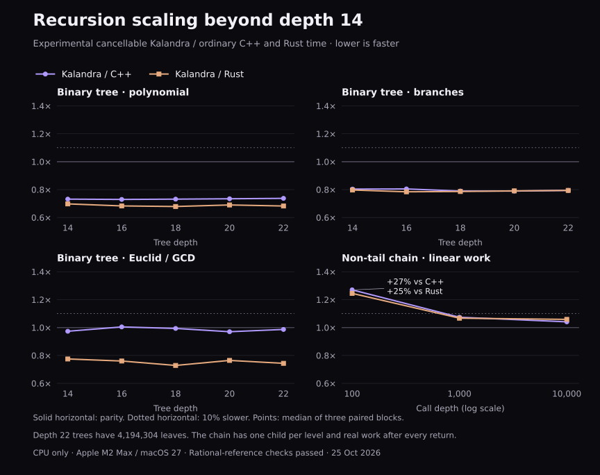

# Recursion scaling beyond depth 14 — 25 October 2026

The tree advantage survives the tested expansion to depth 22, but it is not a universal recursion advantage. A genuine 100-level non-tail chain takes **27.0% more time than C++ and 24.5% more than Rust**, missing the 10% target. The chain is within the target at depths 1,000 and 10,000. These are still experimental hybrid cancellation results, not a production scheduler integration.



## Two different questions

The original programs make two recursive calls at every level, so depth 100 requires about 1.27 × 10^30 leaves. They also double an int64 argument at each edge: with seed 17, the leftmost path overflows on its 59th doubling. Running those actual Kalandra programs at depth 100 correctly reports arithmetic fault 4; it is not a completed performance benchmark. Nine program/mode cases check that behavior (three algorithms × unbound/current/hybrid). The unchecked C++/Rust variants were not executed at depth 100.

To test increasing work with the original algorithms, the tree study uses depths 14, 16, 18, 20 and 22: 16,384 through 4,194,304 leaves, a 256× expansion.

To test actual deep call stacks without exponential work or overflowing inputs, the new chain makes one recursive call per level, bounds the integer state modulo 1,000,003, then performs floating-point arithmetic **after** its child returns. This deliberately different workload has O(depth) work. The generated assembly for all three languages contains a growing recursive call followed by multiplication/addition; this is not a tail-call loop or a closed-form replacement. Depths 100, 1,000 and 10,000 all complete.

## Paired performance

Ratios are experimental Kalandra hybrid time / reference time; below 1 is faster, above 1.1 misses the requested target. Each cell uses three adjacent ABBA/BAAB blocks, identical iteration counts within each pair and a roughly 20 ms batch target. Table entries are median paired ratios, not ratios of independent grand means. C++/Rust are ordinary optimized programs without cancellation.

| Workload | Depth | Work units | Hybrid / C++ | Hybrid / Rust |
| --- | ---: | ---: | ---: | ---: |
| Polynomial | 14 | 16,384 leaves | 0.732 | 0.698 |
| Polynomial | 16 | 65,536 leaves | 0.729 | 0.683 |
| Polynomial | 18 | 262,144 leaves | 0.732 | 0.679 |
| Polynomial | 20 | 1,048,576 leaves | 0.734 | 0.690 |
| Polynomial | 22 | 4,194,304 leaves | 0.737 | 0.682 |
| Branches | 14 | 16,384 leaves | 0.804 | 0.797 |
| Branches | 16 | 65,536 leaves | 0.805 | 0.784 |
| Branches | 18 | 262,144 leaves | 0.790 | 0.786 |
| Branches | 20 | 1,048,576 leaves | 0.789 | 0.791 |
| Branches | 22 | 4,194,304 leaves | 0.794 | 0.794 |
| Euclid / GCD | 14 | 16,384 leaves | 0.973 | 0.775 |
| Euclid / GCD | 16 | 65,536 leaves | 1.005 | 0.760 |
| Euclid / GCD | 18 | 262,144 leaves | 0.994 | 0.728 |
| Euclid / GCD | 20 | 1,048,576 leaves | 0.970 | 0.764 |
| Euclid / GCD | 22 | 4,194,304 leaves | 0.987 | 0.744 |
| Non-tail chain | 100 | 100 recursive edges | 1.270 | 1.245 |
| Non-tail chain | 1,000 | 1,000 recursive edges | 1.074 | 1.067 |
| Non-tail chain | 10,000 | 10,000 recursive edges | 1.041 | 1.059 |

At depth 22, polynomial takes 26.3% less time than C++ and 31.8% less than Rust; branching takes about 20.6% less than each. GCD remains near C++ parity and takes 25.6% less time than Rust. These are source-level recursive algorithms, without tensor/reduction built-ins or optimized numerical libraries.

The [follow-up entry ablation](cancellation-entry-ablation-2026-10-25.md) isolates benchmark-only costs: two heap state allocations and a per-invocation latency timestamp. With matched batch warmups, stack state and no latency instrumentation, the depth-100 gap falls to roughly 16–17% but still misses the target. The original scores above remain retained as measured.

## Why the 100-level result is worse

A separate randomized three-trial control uses the same compiled kernels and task harness:

| Execution mode | Zero-depth boundary (ns) | Depth 100 (ns) | Depth 1,000 (ns) | Depth 10,000 (ns) |
| --- | ---: | ---: | ---: | ---: |
| C++ | 1.79 | 859.52 | 9,028.50 | 91,667.92 |
| Rust | 3.71 | 862.92 | 9,049.50 | 91,026.04 |
| Kalandra unbound floor | 163.02 | 1,070.38 | 9,493.81 | 95,939.16 |
| Kalandra existing bound path | 158.11 | 1,115.50 | 10,106.69 | 99,011.67 |
| Kalandra experimental hybrid | 168.30 | 1,060.01 | 9,841.08 | 95,199.17 |

The approximately 168 ns hybrid zero-depth control includes heap-based experiment state, an invocation, callback/cleanup admission and settlement. C++/Rust only call their scalar kernel in this harness. This provides evidence that much of the short-chain gap is fixed root invocation cost, rather than a cliff at 100 native frames. It also shows why similar fractional root costs matter less as useful work increases. These diagnostic controls are not paired with the main scores; they are not subtracted from or substituted into those scores.

Native Kalandra chain frames retain integer overflow and physical-stack checks. C++/Rust do not have equivalent automatic cancellation/checked-arithmetic admission. The experiment aims to meet their default performance despite that distinction. The 100-level result remains a real failure of the end-to-end target for this task granularity. Production may embed or reuse state differently; no hypothetical amortization is counted as a measured win.

## Numerical and semantic checks

390 program/seed/depth/mode verification cases cover C++, Rust, unbound Kalandra, existing bound Kalandra and the hybrid, using seeds 1, 17 and 31. Every case produces three independently checked result samples. Branching and GCD match the rational/integer reference exactly; polynomial and chain results differ by at most **one ULP** from the correctly rounded exact rational reference in this run (the declared qualification threshold was two ULP). Larger polynomial sums are not falsely described as bit-exact.

Branching references independently sum arithmetic progressions for the three residue classes. GCD references use gcd(13x+7, 7x+11) dividing 94, counting parity and residues 32 mod 47 / 79 mod 94. Those formulas are first checked against direct Fraction and math.gcd enumeration on tractable domains. The chain oracle computes its entire recurrence with Fraction. Timed repeated-sum checksum checks explicitly allow only the per-result qualification error plus the standard accumulated addition-rounding bound. Every Kalandra invocation checks expected status and balanced allocation/settlement. No compiler/runtime production code changed.

C++ numerical kernels are a separate translation unit at -O2 with contraction disabled. Rust is opt-level=2 without LTO. The prototype uses the same reserved-register, callback adapter, linked PC metadata and cleanup boundary as the earlier mechanism study. Only the probe warmup count is changed from twenty to two for all new Kalandra modes; this is recorded in generated DepthProbe.cpp and its hash. Both warmup tasks are outside timing; per-invocation setup/cleanup remains timed.

## Evidence and reproduction

- [Scaling samples, checks, commands and hashes](cancellation-depth-scaling-2026-10-25.json)
- [Root-entry control samples and hashes](cancellation-depth-controls-2026-10-25.json)
- [Machine-code excerpts confirming genuine non-tail recursion](cancellation-depth-frames-2026-10-25.txt)
- [Scaling runner](../../native/experiments/cancellation/depth_run.py)
- [Control runner](../../native/experiments/cancellation/depth_controls.py)

```sh
python3 native/experiments/cancellation/depth_run.py /tmp/depth-scaling.json
python3 native/experiments/cancellation/depth_controls.py /tmp/depth-controls.json
# Optional chart renderer requires Matplotlib.
python3 native/experiments/cancellation/depth_chart.py /tmp/depth-scaling.json /tmp/depth-scaling
```

Darwin ARM64 / Apple M2 Max / macOS 27; the pinned compiler and toolchain. This does not qualify other platforms or general GPU source recursion. The study supports scaling through the measured depths and identifies a small-task regression; it does not establish performance at all depths or on all recursive algorithms.
