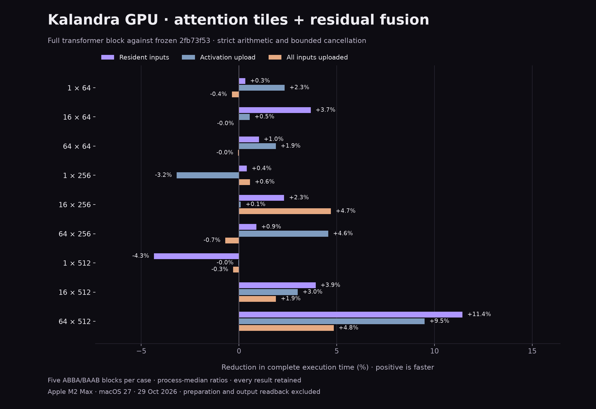

# Attention contraction parallelism and guarded residual fusion

Against frozen `2fb73f53`, 19/27 full-block paired medians improve; 6 cases improve in every block. All negative results remain visible below. Numerical arithmetic remains strict.

## Implementation and semantics

- Small-output matrices can select the existing contraction-parallel kernel: 3–64 rows, 8–64 columns, inner dimension 256–4096 and divisible by 32. The existing one/two-row wide profile is unchanged. No primitive numerical shader changes. The rule is based on dimensions and applies outside transformer programs; this tuning is physically measured on M2 Max only.
- The compiler places a nearby matrix result first in a map’s parameter ABI without changing expression operand/evaluation order. The runtime can fuse a proven non-faulting float32 map with one extra resident tensor, across an optional shape check that already passes from predicted output metadata. Failed/unavailable captures retain staged execution and fault precedence. Original generated programs remain compatible with the new runtime.
- The complete block uses 12 dispatches instead of 14; the large block uses six submissions instead of seven. Both computational operations are charged to the existing four-logical-stage / estimated 64 Mi-work quantum. Its existing oversized-single-fused-dispatch exception remains; no unrelated work is appended. Physical checkpoint placement changes within that contract. Products, float32 rounding and adjacent-pair reductions are unchanged; no FMA, precision relaxation or vendor numerical dependency is added.
- Compiler binary changes are confined to the Metal program emitter; full-block CPU LLVM and the task runtime archive are byte-identical. Six original stage sources remain identical. The residual map’s two canonical input loads swap ABI slots and gain an epilogue library; an exact source check proves that substitution preserves operand order. This is not a claim that every generated shader source is unchanged.

See the [lifetime and cancellation design](../../docs/design/gpu-guarded-matrix-epilogues.md).

## Complete-block acceptance

Percentages are reductions in API time. Parentheses show positive blocks out of five. Pipeline loading, immutable-plan preparation and output readback are excluded; capture binding, device ACK, task observation and retirement remain inside timing. Transfers are included in their respective modes.

| Rows × width | Resident | Activation upload | All seven uploads |
|---|---:|---:|---:|
| 1 × 64 | +0.32% (3/5) | +2.33% (5/5) | -0.36% (2/5) |
| 16 × 64 | +3.67% (3/5) | +0.55% (3/5) | -0.01% (2/5) |
| 64 × 64 | +1.02% (4/5) | +1.89% (4/5) | -0.04% (2/5) |
| 1 × 256 | +0.40% (3/5) | -3.18% (0/5) | +0.56% (3/5) |
| 16 × 256 | +2.31% (5/5) | +0.09% (3/5) | +4.70% (4/5) |
| 64 × 256 | +0.89% (4/5) | +4.56% (4/5) | -0.70% (2/5) |
| 1 × 512 | -4.35% (1/5) | -0.03% (2/5) | -0.30% (1/5) |
| 16 × 512 | +3.92% (4/5) | +3.01% (4/5) | +1.89% (5/5) |
| 64 × 512 | +11.44% (5/5) | +9.50% (5/5) | +4.85% (5/5) |

## Fusion-only control

Three separate paired blocks use exactly the same new shader bundle and generated header, with the attention policy enabled in both runtimes. Only residual-fusion support differs. The first policy-only transformer screen was mixed; direct matrix tests motivated keeping the selection policy. This control separates that policy from the broader fusion change.

| Rows × width | Resident | Activation | All uploads |
|---|---:|---:|---:|
| 1 × 64 | +1.60% | +3.23% | +3.72% |
| 16 × 64 | -0.06% | +2.64% | +4.36% |
| 64 × 64 | +5.42% | -0.25% | -2.58% |
| 1 × 256 | +0.78% | +2.13% | +0.88% |
| 16 × 256 | +3.30% | +1.64% | -0.98% |
| 64 × 256 | +1.11% | +2.75% | -0.41% |
| 1 × 512 | +0.35% | +3.61% | +4.60% |
| 16 × 512 | +3.52% | +2.24% | +0.96% |
| 64 × 512 | +14.68% | +10.28% | +2.15% |

## Small-case replication and rejected admission rule

The first study showed a 3.18% loss in all five blocks for 1×256 activation upload, and a 4.35% resident loss at 1×512. A separate five-block run retained losses of 1.03% and 1.98% respectively, with mixed block signs. The largest-case resident reduction repeated at 12.78% in all five blocks. Small-workload parity is not established; the losses are retained, not dismissed as universally insignificant.

An isolated three-block alternative disables only binary fusion for single-row outputs. It gives mixed results and does not fix the activation-upload case consistently, so it is rejected. Its unchanged large-case control also varies. Positive percentages in that control mean staging is faster; its signs must not be interpreted as gains over the original baseline.

| Rows × width | Repeated baseline comparison: resident / activation / all | Staging instead of fusion: resident / activation / all |
|---|---:|---:|
| 1 × 64 | -1.66% / -1.87% / +1.11% | -0.37% / -1.42% / +3.48% |
| 1 × 256 | +0.74% / -1.03% / +0.13% | +1.21% / -3.19% / +0.19% |
| 1 × 512 | -1.98% / +1.43% / +2.28% | +0.90% / +1.62% / -0.97% |
| 64 × 512 | +12.78% / +7.59% / +5.51% | -1.24% / +2.16% / -0.02% |

## General matrix confirmation

Five-block resident API tests verify every output cell against exact integer contractions divided by 64, outside timing. Boundary controls outside the new policy are retained. This is a matrix primitive result, not a claim of the same percentage improvement in a complete model.

| M × K × N | Time reduction | Positive blocks |
|---|---:|---:|
| 2 × 512 × 16 | +3.65% | 3/5 |
| 3 × 4096 × 8 | +56.04% | 5/5 |
| 4 × 256 × 8 | +21.44% | 5/5 |
| 8 × 256 × 16 | +19.00% | 5/5 |
| 16 × 224 × 16 | -1.37% | 1/5 |
| 16 × 256 × 16 | +19.02% | 5/5 |
| 16 × 288 × 16 | +17.39% | 5/5 |
| 16 × 512 × 16 | +22.45% | 5/5 |
| 16 × 512 × 65 | -0.66% | 2/5 |
| 17 × 544 × 17 | +21.80% | 5/5 |
| 32 × 1024 × 32 | +31.18% | 5/5 |
| 64 × 256 × 64 | +17.63% | 5/5 |
| 64 × 512 × 64 | +17.54% | 5/5 |
| 64 × 2048 × 64 | +37.25% | 5/5 |
| 64 × 4096 × 64 | +43.77% | 5/5 |
| 65 × 512 × 64 | +3.28% | 4/5 |

## Fresh CPU/Metal/MPSGraph controls

Equivalent bias-free unmasked single-head transformer block with pre-RMSNorm, four-times-width ReLU FFN and two residuals; this is not full model inference or generation. Vendor outputs meet the independent bound but need not share Kalandra’s reduction/FMA choices. MPSGraph remains benchmark-only; the wrapper encode count does not prove its internal submission count.

| Rows × width | CPU µs | Kalandra GPU µs | MPSGraph µs | CPU / GPU | GPU / MPS |
|---|---:|---:|---:|---:|---:|
| 1 × 64 | 14.70 | 933.81 | 297.55 | 0.02× | 3.14× |
| 16 × 64 | 68.10 | 949.32 | 317.73 | 0.07× | 2.99× |
| 64 × 64 | 262.10 | 1024.70 | 322.06 | 0.26× | 3.18× |
| 1 × 256 | 58.19 | 984.60 | 310.06 | 0.06× | 3.18× |
| 16 × 256 | 1156.19 | 1108.55 | 362.82 | 1.04× | 3.06× |
| 64 × 256 | 2685.70 | 1403.62 | 433.46 | 1.91× | 3.24× |
| 1 × 512 | 257.81 | 934.35 | 316.22 | 0.28× | 2.95× |
| 16 × 512 | 4980.67 | 1321.72 | 450.97 | 3.77× | 2.93× |
| 64 × 512 | 10715.57 | 1709.17 | 524.14 | 6.27× | 3.26× |

Previous large-case pipeline setup: 2.424 ms; plan preparation: 9.56 µs. These setup observations come from separate studies, not a paired startup experiment.

Current large-case pipeline setup: 2.705 ms; plan preparation: 9.60 µs. These setup observations come from separate studies, not a paired startup experiment.

## Qualification

- Optimized, debug, ASan/UBSan and TSan pass 1,745 APFloat cases / 1,769,284 cell/aggregate checks per mode. Attention domain edges, IEEE values, partial tiles and non-power-of-two reductions are included.
- Prepared graphs pass expanded binary/unary IEEE bit-pattern comparisons, noncommutative operand order, empty/failing guards, prior device-failure and cancellation precedence, original-input/alias safety, allocation-failure injection, every 4/6 submission boundary, concurrent calls, core teardown and low-budget/long-graph fallback. Generated source entry points run in all four modes.
- CPU/Metal/MPS control validation: 91 records / 476,455 independent cell checks. All frozen and compatibility dumps are bit-identical. Numeric compiler, four-mode all-ten-type CLI programs and legacy graph batching passed. The CLI harness now accepts the shader-validation informational notice; numeric/exit checks remain strict.
- Diagnostic profiling is separate from acceptance. GPU command intervals and recorded encoding are not an exhaustive exclusive-time breakdown. No timing runs overlap builds, tests, profiling or plotting.

- Profile 1 × 512: wall 1.271 ms, GPU command intervals 0.447 ms, recorded encoding 0.079 ms; 4 submissions / 12 dispatches.
- Profile 64 × 512: wall 2.784 ms, GPU command intervals 1.447 ms, recorded encoding 0.118 ms; 6 submissions / 12 dispatches.

## Remaining work

MPSGraph remains ahead and small blocks still favor CPU. The small-case losses remain open; the single-row staging control does not justify an extra admission rule. Next experiments should isolate invocation/transfer latency and test a snapshot-preserving unified-memory upload policy against matched vendor controls. Wider fusion must retain operand order, numerical rounding and the cancellation contract.

## Evidence and reproduction

Baseline artifacts were frozen before edits under `benchmarks/.build/gpu-attention-2026-10-29/baseline`; regenerate from `2fb73f53`. Raw JSON retains every calibration/sample, exact commands, source/artifact hashes and hardware/toolchain metadata. Rejected/noisy screening outcomes are retained alongside final acceptance. GPU numerical libraries are generated from the recorded compiler source.

- [transformer-attention-full-block-2026-10-29.json](transformer-attention-full-block-2026-10-29.json) — SHA256 `9bae2edf4dc65c7ab2300cc57da5cc35e80e684fdd8d058481832cb34f9e410f`
- [transformer-attention-paired-2026-10-29.json](transformer-attention-paired-2026-10-29.json) — SHA256 `4547ba53fc2f13aaa7083a6439d3d9a90169c985cec8271815a614721c5cc1ae`
- [transformer-attention-profile-2026-10-29.json](transformer-attention-profile-2026-10-29.json) — SHA256 `ea3563e0745083f5114b3c9d768ff2d07b2ac5603d83006455050d3b165a81e3`
- [transformer-attention-qualification-2026-10-29.json](transformer-attention-qualification-2026-10-29.json) — SHA256 `e3f904011c0dd9a11ef2e035a13f9a8b6dcd4e9ae3376dbb1d1e46b3b0f53b3b`
- [transformer-attention-isolation-2026-10-29.json](transformer-attention-isolation-2026-10-29.json) — SHA256 `064591f4a3486c0273bd1ec915382673ad11ef4f225fbc56398aab47051fd81a`
- [transformer-attention-policy-screen-2026-10-29.json](transformer-attention-policy-screen-2026-10-29.json) — SHA256 `430217c6054b51e600cc51172d89d4205e99372e16d73d120b04909201f95489`
- [gpu-attention-rectangles-screen-2026-10-29.json](gpu-attention-rectangles-screen-2026-10-29.json) — SHA256 `9c9c880e0d42cba362ec829db6e36decb94a42e8b9a7059997760195ac2c58e5`
- [gpu-attention-rectangles-2026-10-29.json](gpu-attention-rectangles-2026-10-29.json) — SHA256 `43fd20c48c1d299204e46800595b55bc00fecf0779438077d080882044442d21`
- [transformer-attention-small-repeat-2026-10-29.json](transformer-attention-small-repeat-2026-10-29.json) — SHA256 `64389c5e2aabbde10a483a0cbf1c05e0e0732bea88fc4c2eec4c3e6edb4d28dd`
- [transformer-attention-single-row-2026-10-29.json](transformer-attention-single-row-2026-10-29.json) — SHA256 `c973b54ce812f2905ea16fd4503c3d46c00ecc7274687dae185d197f58418599`

Reproduction entry points: `attention_policy.py`, `attention_rectangles.py`, `transformer_block.py`, `residual_execution.py` (with `--allow-epilogue-extension`), `residual_isolation.py` and `transformer_profile.py --dispatches 12 --large-submissions 6`. Use the exact arguments recorded in each JSON; regenerate ignored artifacts before auditing/rendering.
