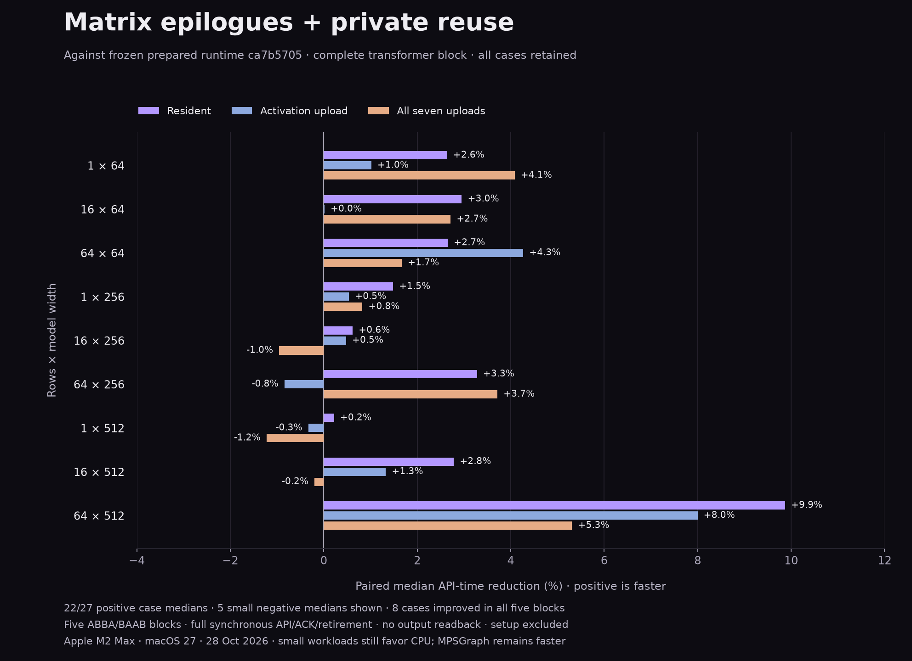

# Typed matrix epilogues and private intermediate reuse

Against frozen `ca7b5705`, the largest resident block takes **9.9% less API time**, and its all-inputs-uploaded case takes **5.3% less**. In a separate CPU/Metal/MPSGraph run, resident 64 × 512 is **4.90× faster on Metal than CPU**.

This is not a universal win: **22/27** case medians improve and **5/27** are 0.2–1.2% slower. Only 8 cases improve in every paired block. The negative medians have mixed block signs; their evidence is retained and no broad small-workload speedup is claimed.



## Implementation

- Compiler-proven, non-faulting single-input float32 maps can become matrix epilogues when immediately adjacent to a single-consumer product. The pinned converter’s canonical straight-line form is required; indexing, control flow, stores, types or layouts outside that form keep separate stages. Profiles are emitted only for actual adjacent matrix producers, so ordinary maps avoid unused pipeline creation.
- The original matrix shader and reduction tree remain intact. The epilogue operates on the completed float32 value through the same uint bit carriers as the staged map. No FMA contraction or reassociation is enabled. The transformer fuses attention-score scaling and the feed-forward ReLU; residual-add fusion across shape guards is not implemented.
- Each invocation tracks private allocation origins. A pointwise map may overwrite a private last-use value only when no other live value aliases its backing. Input aliases remain original inputs; result observation counts as a live use. Checked maps, transforms, original inputs and live/escaping aliases are excluded. Inputs do not gain user-visible mutation or ownership requirements.
- Both fused logical stages count toward the existing four-stage quantum. Both parameter buffers stay charged until ACK. A fused oversized product is one isolated dispatch; other work is not appended to it. Cancellation remains cooperative and task settlement waits for the in-flight command. Fault precedence and cleanup are preserved.
- The stale LSP `tra` prefix expectation was corrected in `a97e91b3`: both `transfer` and `transpose` are valid. Debug/sanitized protocol tests passed locally; Linux and Windows hosted qualification passed on that correction.

## Frozen paired comparison

Five ABBA/BAAB blocks per shape/residency case use adjacent fresh processes and identical iterations within each pair. Calibration targets the faster implementation. Pipeline loading and immutable plan preparation are excluded; hot capture binding, task/group setup, GPU ACK and retirement are included. Output readback is excluded on both GPU paths.

Times are medians of paired block means; reductions are medians of within-block ratios. These distinct median operations mean a displayed time ratio can differ slightly from the percentage. “Blocks +” counts faster candidate blocks out of five.

| Rows × width | Resident before → after (ms) | Resident reduction | Blocks + | Activation reduction | All-upload reduction |
|---|---:|---:|---:|---:|---:|
| 1 × 64 | 0.974 → 0.960 | +2.64% | 3/5 | +1.02% | +4.08% |
| 16 × 64 | 1.017 → 1.001 | +2.95% | 5/5 | +0.02% | +2.71% |
| 64 × 64 | 1.071 → 1.038 | +2.65% | 5/5 | +4.27% | +1.67% |
| 1 × 256 | 1.006 → 1.013 | +1.48% | 4/5 | +0.54% | +0.83% |
| 16 × 256 | 1.119 → 1.121 | +0.62% | 3/5 | +0.48% | -0.95% |
| 64 × 256 | 1.497 → 1.460 | +3.28% | 5/5 | -0.84% | +3.71% |
| 1 × 512 | 0.964 → 0.962 | +0.22% | 3/5 | -0.33% | -1.22% |
| 16 × 512 | 1.631 → 1.598 | +2.78% | 5/5 | +1.33% | -0.20% |
| 64 × 512 | 2.450 → 2.186 | +9.87% | 5/5 | +8.00% | +5.31% |

Negative medians:

- 1 × 512, activation upload: -0.33%; block range -18.6% to +0.9%.
- 1 × 512, all seven uploads: -1.22%; block range -4.9% to +1.5%.
- 16 × 256, all seven uploads: -0.95%; block range -2.5% to +1.6%.
- 16 × 512, all seven uploads: -0.20%; block range -1.1% to +2.4%.
- 64 × 256, activation upload: -0.84%; block range -5.1% to +3.8%.

Large transients remain visible in raw data, including a −29% block in the 64 × 512 activation-upload case. No outlier was removed and no follow-up run was substituted for a losing case. Five blocks provide limited precision for effects near 1%.

## CPU and optimized-library control

These times come from a separate counterbalanced CPU/Metal/MPSGraph run; they are not spliced into the frozen paired comparison. MPSGraph remains a benchmark-only control with its own fusion/reduction strategies, verified against independent per-cell forward-error bounds.

| Rows × width | CPU (ms) | Metal (ms) | MPSGraph (ms) | CPU / Metal speedup | Metal / MPS time |
|---|---:|---:|---:|---:|---:|
| 1 × 64 | 0.015 | 1.002 | 0.313 | 0.01× | 3.20× |
| 16 × 64 | 0.069 | 1.039 | 0.318 | 0.07× | 3.27× |
| 64 × 64 | 0.267 | 1.055 | 0.327 | 0.25× | 3.23× |
| 1 × 256 | 0.059 | 1.052 | 0.308 | 0.06× | 3.41× |
| 16 × 256 | 1.163 | 1.208 | 0.380 | 0.96× | 3.18× |
| 64 × 256 | 2.751 | 1.545 | 0.428 | 1.78× | 3.61× |
| 1 × 512 | 0.273 | 0.995 | 0.322 | 0.27× | 3.09× |
| 16 × 512 | 4.930 | 1.611 | 0.459 | 3.06× | 3.51× |
| 64 × 512 | 10.973 | 2.237 | 0.534 | 4.90× | 4.19× |

Small workloads still favor CPU; Metal beats CPU in three resident cases. The largest resident Metal case remains about 4.2× the MPSGraph time. The retained “Failed to import MPS module” framework diagnostic did not prevent execution or verification. This is a bias-free, single-head, unmasked pre-RMSNorm block with unit RMS gain, separate Q/K/V and output projections, attention softmax, two residuals and a 4× ReLU feed-forward layer; it is not token generation, KV caching or an end-to-end LLM.

## Setup and isolated profiling

An independent alternating-order fresh-process setup diagnostic excludes Runtime creation, uploads and process launch. Program/pipeline setup rises from **1.813 ms to 2.234 ms**; the extra fused pipeline states cost about **0.421 ms**. Median plan preparation is 7.83 µs before and 7.81 µs after. This is a warm-throughput optimization with an explicit cold-setup cost.

Instrumented wall time below is diagnostic, not acceptance timing. Recorded encoding counters omit some setup and do not form an exhaustive exclusive-time breakdown with GPU time.

| Resident case | Submissions / dispatches | Allocation/admission checkpoints | Wall (ms) | GPU command time (ms) | Recorded encoding (ms) |
|---|---:|---:|---:|---:|---:|
| 1 × 512 | 4 / 14 | 112 | 1.404 | 0.462 | 0.101 |
| 64 × 512 | 7 / 14 | 115 | 2.298 | 0.722 | 0.140 |

The prior prepared profile had 16 dispatches, 4/8 submissions and 127/131 checkpoints. The candidate has 14 dispatches, 4/7 submissions and 112/115 checkpoints. Remaining acknowledgement/driver and allocation work is substantial; the profile does not prove all unaccounted wall time is scheduler waiting. The next architectural experiment is GPU-side graph progression with device-visible cancellation/fault gates, retaining first-fault ordering and ACK-scoped retirement. Residual/projection fusion across validated shape guards is another candidate. Neither is claimed implemented here.

## Qualification and evidence

- Full block: 91 verification records / 476,455 output-cell checks across 13 shapes and all residency modes. The frozen baseline/candidate dumps match bit-for-bit across all 67,392 cells in nine non-dyadic comparison shapes.
- Four runtime modes (optimized, debug, ASan/UBSan, TSan): 60 fused IEEE/odd-reduction fixtures per mode match staged output bits, with one dispatch per pair. Provenance graphs verify private last-use reuse, live aliases, original-input aliases and escaping results; held backing counts and original input bits are checked.
- Four-mode lifecycle: 112 injected hot-path allocation checkpoints, changing epsilon/scale, eight concurrent invocations, held cancellation/deadline/device failure at all four small-block boundaries, deferred host-fault precedence, dropped plan handles, teardown and 16/32/64 KiB budgets.
- Independent row math: 48 configurations / 145,332 checks; typed hardware matrices: 1,724 APFloat cases / 1,598,840 cell/aggregate checks per mode across all four modes. Typed all-ten-type matrix programs, legacy graph batching and canonical-epilogue rejection tests passed.
- CPU full-block LLVM is byte-identical to the frozen baseline. Original unfused shader source is identical; only the two eligible map libraries append fused entry points. The unchanged primitive source and changed fused-kernel hashes are recorded explicitly.
- Relocated distribution qualification is recorded in the qualification manifest. Tests, profiling, setup diagnostics, compilation and plotting were separate from both acceptance timing runs.

- [transformer-fusion-full-block-2026-10-28.json](transformer-fusion-full-block-2026-10-28.json) — SHA256 `213513f630f63e66355a9c4fdebc74383676213703c373ff0eac43e6d52a949b`
- [transformer-fusion-paired-2026-10-28.json](transformer-fusion-paired-2026-10-28.json) — SHA256 `9ea4f489a2b335903cdd12a21bfe2825dd8b45eebdd60a8ea275d1842d13514c`
- [transformer-fusion-profile-2026-10-28.json](transformer-fusion-profile-2026-10-28.json) — SHA256 `b15adf6372a97294ac3956058ab053019c2156c1f937d7d0fef707eabddd43ae`
- [transformer-fusion-setup-2026-10-28.json](transformer-fusion-setup-2026-10-28.json) — SHA256 `a7eee1f22ec6e3b7ee5dc0b05f8848ab1286aee53e7888048ba68e32ccaa799c`
- [Qualification manifest](transformer-fusion-qualification-2026-10-28.json).

## Reproduction

Baseline artifacts were frozen before edits in `benchmarks/.build/gpu-fusion-2026-10-28/baseline`; its manifest is embedded in paired evidence. The baseline shader bundle is `benchmarks/.build/typed-execution-2026-10-28/acceptance/bundle`. Ignored build artifacts are not committed: regenerate the runtime from `ca7b5705` on another machine. Exact commands, all samples/calibration, source/artifact hashes and toolchain versions are retained in evidence. Setup-harness source snapshots are in its JSON. Use fresh paths because timing runners refuse overwrites.

```sh
python3 native/benchmarks/transformer_block.py --build-dir benchmarks/.build/gpu-fusion-2026-10-28/acceptance --output benchmarks/results/transformer-fusion-full-block-2026-10-28.json --blocks 5 --target-ms 30
python3 native/benchmarks/prepared_execution.py --baseline benchmarks/.build/gpu-fusion-2026-10-28/baseline --baseline-bundle benchmarks/.build/typed-execution-2026-10-28/acceptance/bundle --current-evidence benchmarks/results/transformer-fusion-full-block-2026-10-28.json --output benchmarks/results/transformer-fusion-paired-2026-10-28.json --blocks 5 --allow-epilogue-extension
python3 native/benchmarks/transformer_profile.py --evidence benchmarks/results/transformer-fusion-full-block-2026-10-28.json --build-dir benchmarks/.build/gpu-fusion-2026-10-28/profile --output benchmarks/results/transformer-fusion-profile-2026-10-28.json --dispatches 14 --large-submissions 7
```
