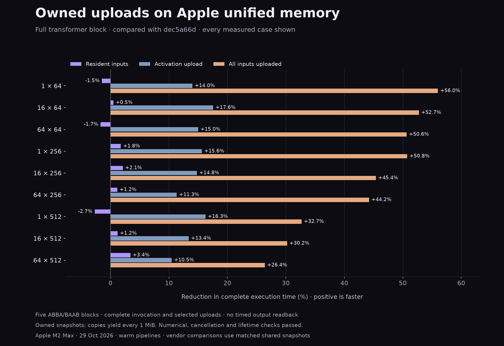

# Owned shared-upload acceptance — 29 October 2026

The runtime copies CPU inputs into owned shared Metal buffers on unified-memory devices. It removes staging/private blits and their submissions while yielding after each 1 MiB copy chunk. GPU compute kernels, arithmetic, compiler and TaskCore are unchanged. Non-unified devices retain the private-buffer fallback.

All-upload medians improve **26.4–56.0%**, with every block positive in every case. Activation-upload medians improve **10.5–17.6%**. The independent repeat confirms **25.3–51.6%** all-upload reductions. Resident results are mixed: primary losses reach **2.7%**, while the repeat changes their signs and includes a **2.9%** loss at 1×256. This is an accepted transfer optimization, not a claim of improved resident latency.

## Frozen baseline comparison

Five adjacent ABBA/BAAB blocks against `dec5a66d`; positive is less execution time. The current and baseline use the same generated program and shader bundle. All 27 outcomes are retained. The resident comparison still changes input storage placement even though allocation/upload time is outside its timing.

| Tokens × width | Resident | Activation upload | All inputs uploaded |
|---|---:|---:|---:|
| 1 × 64 | -1.46% (0/5 positive) | +14.04% (5/5 positive) | +56.00% (5/5 positive) |
| 16 × 64 | +0.51% (3/5 positive) | +17.58% (5/5 positive) | +52.74% (5/5 positive) |
| 64 × 64 | -1.69% (1/5 positive) | +14.99% (5/5 positive) | +50.65% (5/5 positive) |
| 1 × 256 | +1.77% (4/5 positive) | +15.65% (5/5 positive) | +50.75% (5/5 positive) |
| 16 × 256 | +2.11% (4/5 positive) | +14.78% (5/5 positive) | +45.40% (5/5 positive) |
| 64 × 256 | +1.17% (3/5 positive) | +11.34% (3/5 positive) | +44.24% (5/5 positive) |
| 1 × 512 | -2.68% (0/5 positive) | +16.27% (5/5 positive) | +32.69% (5/5 positive) |
| 16 × 512 | +1.22% (3/5 positive) | +13.40% (5/5 positive) | +30.22% (5/5 positive) |
| 64 × 512 | +3.40% (3/5 positive) | +10.48% (5/5 positive) | +26.40% (5/5 positive) |

## Same-binary storage control

Both Kalandra policies use the exact same candidate executable. Only its internal shared-upload option changes. Both MPS policies also use one executable. Three blocks per group, with all outcomes retained. This separates storage selection from linking/code-layout changes.

| Tokens × width | Implementation | Resident | Activation | All uploads |
|---|---|---:|---:|---:|
| 1 × 64 | kalandra | -1.82% | +18.66% | +55.52% |
| 1 × 64 | mps | +2.32% | +33.32% | +73.32% |
| 16 × 64 | kalandra | -1.48% | +16.84% | +53.54% |
| 16 × 64 | mps | +0.22% | +31.74% | +72.33% |
| 64 × 64 | kalandra | -1.61% | +13.15% | +51.91% |
| 64 × 64 | mps | +3.20% | +33.92% | +73.76% |
| 1 × 256 | kalandra | +1.01% | +8.79% | +49.99% |
| 1 × 256 | mps | +0.69% | +34.22% | +56.23% |
| 16 × 256 | kalandra | +1.31% | +17.84% | +47.47% |
| 16 × 256 | mps | +0.54% | +30.18% | +56.77% |
| 64 × 256 | kalandra | +3.91% | +14.07% | +43.52% |
| 64 × 256 | mps | -0.90% | +29.16% | +55.19% |
| 1 × 512 | kalandra | -1.14% | +14.71% | +33.10% |
| 1 × 512 | mps | -1.88% | +31.87% | +7.64% |
| 16 × 512 | kalandra | +0.13% | +13.60% | +29.75% |
| 16 × 512 | mps | -1.60% | +26.25% | +11.64% |
| 64 × 512 | kalandra | -0.04% | +7.48% | +28.11% |
| 64 × 512 | mps | -0.94% | +21.74% | +8.54% |

## Independent replication

Same frozen acceptance binaries; five fresh blocks for three one-token cases and the largest control.

| Tokens × width | Resident | Activation | All uploads |
|---|---:|---:|---:|
| 1 × 64 | +1.59% | +11.03% | +51.64% |
| 1 × 256 | -2.93% | +14.91% | +49.72% |
| 1 × 512 | +1.63% | +15.48% | +33.93% |
| 64 × 512 | +2.51% | +9.76% | +25.33% |

## Write-combined cache experiment

Five paired blocks compare an isolated write-combined upload allocation against the bounded default-cache candidate. Both use the same driver, task archive, program and shaders. The optimized upload lifecycle test passes with validation, and all 15 shape/residency dumps match bit-for-bit. Positive values favor write combining.

| Tokens × width | Resident | Activation | All uploads |
|---|---:|---:|---:|
| 1 × 64 | +1.34% (4/5 positive) | -1.55% (2/5 positive) | -1.75% (1/5 positive) |
| 16 × 64 | +0.26% (3/5 positive) | -1.52% (1/5 positive) | -4.30% (1/5 positive) |
| 1 × 256 | +1.46% (5/5 positive) | +3.11% (5/5 positive) | -7.91% (1/5 positive) |
| 1 × 512 | -13.33% (2/5 positive) | +5.78% (4/5 positive) | -20.77% (0/5 positive) |
| 64 × 512 | +2.16% (5/5 positive) | -0.95% (1/5 positive) | -11.77% (0/5 positive) |

Rejected: write combining loses **20.8% at 1×512 all-upload** and **11.8% at 64×512 all-upload**, with all five blocks negative in each. The mixed resident gains do not justify that tradeoff. Production retains default CPU caching. Apple explicitly notes that [write-combined memory can have performance pitfalls](https://developer.apple.com/documentation/metal/mtlcpucachemode/writecombined); this experiment does not establish the microarchitectural cause of the observed losses.

## Fresh CPU and matched MPSGraph comparison

Times are process-median microseconds from five shuffled rounds of fresh processes. GPU uploads include allocation and a CPU copy into a fresh owned shared buffer for both implementations. No reuse of a mutable host pointer, output readback, pipeline preparation or graph compilation is included. CPU has no upload mode. This is one unmasked single-head bias-free pre-RMSNorm transformer block with a 4× ReLU FFN, not end-to-end LLM generation.

| Tokens × width | Mode | CPU µs | Kalandra Metal µs | MPSGraph µs | Metal / MPS time |
|---|---|---:|---:|---:|---:|
| 1 × 64 | resident | 14.66 | 921.65 | 292.63 | 3.15× |
| 1 × 64 | activation | 14.66 | 910.09 | 301.06 | 3.02× |
| 1 × 64 | all uploads | 14.66 | 925.92 | 364.83 | 2.54× |
| 16 × 64 | resident | 68.15 | 869.17 | 301.69 | 2.88× |
| 16 × 64 | activation | 68.15 | 900.68 | 307.80 | 2.93× |
| 16 × 64 | all uploads | 68.15 | 923.21 | 370.18 | 2.49× |
| 64 × 64 | resident | 265.03 | 983.14 | 306.02 | 3.21× |
| 64 × 64 | activation | 265.03 | 997.85 | 318.70 | 3.13× |
| 64 × 64 | all uploads | 265.03 | 1047.75 | 408.05 | 2.57× |
| 1 × 256 | resident | 57.70 | 955.20 | 281.21 | 3.40× |
| 1 × 256 | activation | 57.70 | 950.45 | 281.61 | 3.38× |
| 1 × 256 | all uploads | 57.70 | 1217.20 | 585.80 | 2.08× |
| 16 × 256 | resident | 1147.94 | 1061.15 | 357.11 | 2.97× |
| 16 × 256 | activation | 1147.94 | 1054.18 | 355.50 | 2.97× |
| 16 × 256 | all uploads | 1147.94 | 1354.20 | 693.71 | 1.95× |
| 64 × 256 | resident | 2676.37 | 1305.36 | 406.62 | 3.21× |
| 64 × 256 | activation | 2676.37 | 1305.43 | 415.12 | 3.14× |
| 64 × 256 | all uploads | 2676.37 | 1613.25 | 732.50 | 2.20× |
| 1 × 512 | resident | 252.10 | 861.66 | 303.09 | 2.84× |
| 1 × 512 | activation | 252.10 | 888.31 | 310.09 | 2.86× |
| 1 × 512 | all uploads | 252.10 | 2322.04 | 1656.80 | 1.40× |
| 16 × 512 | resident | 4850.32 | 1213.94 | 429.79 | 2.82× |
| 16 × 512 | activation | 4850.32 | 1245.57 | 442.16 | 2.82× |
| 16 × 512 | all uploads | 4850.32 | 2729.25 | 1836.24 | 1.49× |
| 64 × 512 | resident | 10624.68 | 1655.13 | 508.70 | 3.25× |
| 64 × 512 | activation | 10624.68 | 1727.19 | 526.72 | 3.28× |
| 64 × 512 | all uploads | 10624.68 | 3143.20 | 1906.40 | 1.65× |

## Qualification and interpretation

- All Kalandra output cells are bit-identical to the frozen baseline across 13 regular/odd shapes and all residency modes. Both MPS storage modes satisfy the independent propagated numerical bounds; vendor arithmetic is not asserted bit-identical.
- Upload lifecycle, ten-format/rank 0–8 storage, compute and numeric tests pass in debug, optimized, ASan/UBSan and TSan builds. Prepared-graph aliases, cancellation, allocation failure, concurrent invocations and generated-source checks pass in all four modes.
- The APFloat suite passes 1,745 cases / 1,769,284 cell and aggregate checks per mode. The existing compute limits and 4–6 submissions, 12 dispatches remain. All measured submission counts are audited: each nonempty shared upload contributes zero GPU submissions instead of one, so all-upload calls fall from 11–13 to 4–6 submissions.
- Uploads retain their own snapshot and CPU lease, yield after at most 1 MiB of copying, and check cancellation before chunks and during publication. Driver allocation is not preemptible; this is no wall-clock deadline guarantee.
- The acknowledged shared-storage and unbounded direct-copy screens are retained separately. Neither is the production acceptance implementation. They motivate the bounded-copy path but do not replace its measured results.
- Resident-only regressions and mixed-sign blocks are shown rather than hidden in aggregate speedups. Transfer gains do not establish GPU parity for tiny resident work or parity with MPSGraph.
- MPSGraph remains a benchmark-only dependency. Production uses Kalandra’s own numerical kernels. No tests, builds or plotting ran alongside acceptance timing.

The first new upload test incorrectly expected a deadline kind on the child task; the established runtime reports cancellation on the child and the deadline on its group. The assertion was corrected to check both. No deadline behavior changed. An overly broad first CTest selection was stopped after the intended tests; the remaining numeric TSan case and corrected upload suites were completed separately.

## Evidence and reproduction

- [transformer-upload-paired-2026-10-29.json](transformer-upload-paired-2026-10-29.json)
- [transformer-upload-storage-2026-10-29.json](transformer-upload-storage-2026-10-29.json)
- [transformer-upload-matched-2026-10-29.json](transformer-upload-matched-2026-10-29.json)
- [transformer-upload-repeat-2026-10-29.json](transformer-upload-repeat-2026-10-29.json)
- [transformer-upload-ack-screen-2026-10-29.json](transformer-upload-ack-screen-2026-10-29.json)
- [transformer-upload-sync-screen-2026-10-29.json](transformer-upload-sync-screen-2026-10-29.json)
- [transformer-upload-qualification-2026-10-29.json](transformer-upload-qualification-2026-10-29.json)
- [transformer-upload-cache-control-2026-10-29.json](transformer-upload-cache-control-2026-10-29.json)

Use `native/benchmarks/upload_experiment.py` for the isolated screens, `native/benchmarks/upload_cache_control.py` for the rejected cache experiment, and `native/benchmarks/upload_acceptance.py` for `paired` (5 blocks), `storage` (3), `matched` (5) and `repeat` (5). Each raw record preserves commands, calibration, every measured/warmup sample, verification metrics and SHA-256 provenance. The shared acceptance build directory is `benchmarks/.build/gpu-upload-2026-10-29/acceptance`. Render with this script after measurements. See [the lifecycle design](../../docs/design/gpu-owned-upload-snapshots.md).
