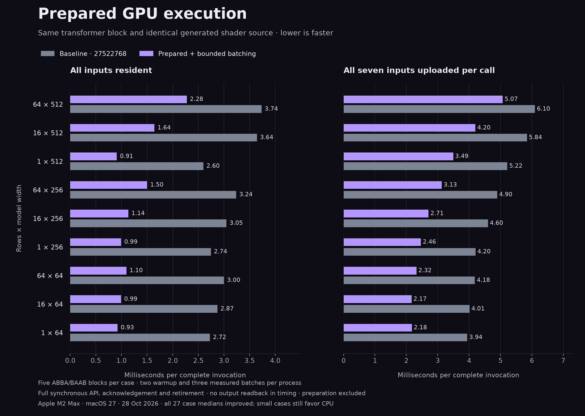

# Prepared typed GPU execution — 28 October 2026

Full-block API time fell **18–66% across all 27 workload/residency case medians** against frozen `27522768`. Every one of the 135 paired blocks improved. The generated shader source is unchanged: this measures execution/ownership improvements, not a different numerical algorithm.



## Implementation and semantics

- Validated immutable instructions, kernel owners, scalar schemas, use counts and map argument templates are prepared once. Each invocation owns its values, use counters, raw scalar captures and deferred-retirement list. Generated host frames reuse plans only on the matching registry/device; scalar bindings are refreshed on every call.
- Batches contain at most four logical stages and 64 Mi estimated work. A single larger dispatch remains individually acknowledged. Emitted fault predicates prove eligible float32 maps non-faulting; hardware float32 products and native transforms have known arithmetic behavior. Host RMS epsilon must also be positive and finite. Checked/unproved arithmetic, device epsilon, readbacks and branches retain boundaries.
- All parameters, scratch, indirect resources and deferred last-use owners remain charged through ACK. A later host preparation/shape fault acknowledges prior encoded work first; an earlier device failure has precedence. Inputs are never donated. Cancellation is cooperative: an already submitted chunk settles on ACK, potentially after four short stages rather than one. Tight workspace budgets keep individual stages.
- This is a private native runtime API change. There is no new language syntax, relaxed arithmetic, vendor dependency or ownership requirement. The CPU full-block LLVM is byte-identical to the prior artifact.

## Frozen before/after comparison

Times below are medians of paired block means. Percentage reductions are medians of within-block ratios, so rounding and different median operations can make them differ slightly from the displayed time ratio. All cells use identical iterations within each ABBA/BAAB pair; calibration targets the faster implementation.

| Rows × width | Resident before → after (ms) | Reduction | Activation upload reduction | All uploads reduction |
|---|---:|---:|---:|---:|
| 1 × 64 | 2.725 → 0.926 | 65.8% | 62.6% | 45.2% |
| 16 × 64 | 2.872 → 0.993 | 65.3% | 62.7% | 46.2% |
| 64 × 64 | 3.001 → 1.097 | 63.4% | 61.0% | 44.4% |
| 1 × 256 | 2.744 → 0.995 | 64.2% | 61.6% | 40.7% |
| 16 × 256 | 3.050 → 1.136 | 62.8% | 59.1% | 40.7% |
| 64 × 256 | 3.240 → 1.502 | 53.4% | 50.6% | 34.6% |
| 1 × 512 | 2.599 → 0.910 | 65.3% | 61.6% | 32.3% |
| 16 × 512 | 3.645 → 1.644 | 52.0% | 49.8% | 29.3% |
| 64 × 512 | 3.735 → 2.276 | 36.5% | 35.9% | 18.0% |

Immutable plan preparation alone takes a median **8.04 µs** across fresh processes (range 6.58–28.67 µs), excluding pipeline loading. It is outside warm timing on both paths; per-invocation capture binding, task/group creation, GPU ACK and retirement remain inside. This is not executable launch latency.

## CPU and optimized-library control

These are a separate counterbalanced CPU/Metal/MPSGraph run; do not splice their times into the paired baseline dataset. MPSGraph is a benchmark-only library control and may use different reduction/fusion strategies within the verified per-cell forward-error envelope.

| Rows × width | CPU (ms) | Metal (ms) | MPSGraph (ms) | CPU / Metal speedup | Metal / MPS time |
|---|---:|---:|---:|---:|---:|
| 1 × 64 | 0.015 | 1.016 | 0.304 | 0.01× | 3.34× |
| 16 × 64 | 0.069 | 1.065 | 0.324 | 0.07× | 3.28× |
| 64 × 64 | 0.266 | 1.109 | 0.331 | 0.24× | 3.35× |
| 1 × 256 | 0.059 | 1.093 | 0.319 | 0.05× | 3.43× |
| 16 × 256 | 1.174 | 1.212 | 0.382 | 0.97× | 3.18× |
| 64 × 256 | 2.776 | 1.649 | 0.437 | 1.68× | 3.78× |
| 1 × 512 | 0.263 | 1.051 | 0.330 | 0.25× | 3.19× |
| 16 × 512 | 5.063 | 1.799 | 0.502 | 2.81× | 3.59× |
| 64 × 512 | 11.184 | 2.582 | 0.552 | 4.33× | 4.68× |

Only three of nine resident cases beat CPU. With all seven uploads included, only the two 512-wide batched cases beat CPU. MPSGraph remains faster in every GPU case; the retained “Failed to import MPS module” framework diagnostic did not prevent execution or output verification. No universal C++/Rust or end-to-end LLM claim is made.

## Isolated instrumentation

Profiled wall times are diagnostics and are not the acceptance times above. Recorded encoding counters omit some helper/setup cost; unaccounted wall time is not proven to be solely condition-variable waiting.

| Resident case | Submissions / dispatches | Allocation/admission checkpoints | Wall (ms) | GPU command time (ms) | Recorded encoding (ms) |
|---|---:|---:|---:|---:|---:|
| 1 × 512 | 4 / 16 | 127 | 1.467 | 0.453 | 0.106 |
| 64 × 512 | 8 / 16 | 131 | 2.544 | 0.740 | 0.168 |

The previous profile used 16 submissions and 235 checkpoints per invocation. Large products exceed the batching work budget, so 64 × 512 still needs eight ACKs. The next targets are projection/pointwise fusion and invocation-local temporary/parameter reuse, while preserving adjacent-pair reductions and checked-fault order. The remaining vendor gap includes both runtime costs and differing library kernel/fusion/math strategies; this profile does not isolate their individual contribution.

## Qualification

- Full model: 91 verification records, 476,455 output-cell checks over 13 shapes and all residency modes; strict nominal and independently propagated float64 error bounds. Frozen baseline/candidate dumps additionally match bit-for-bit for all 67,392 cells across nine non-dyadic comparison shapes.
- Prepared lifecycle: optimized, debug, ASan/UBSan and TSan; changing epsilon/scale, eight concurrent calls, immutable original inputs, all 127 hot-path injected allocation checkpoints, 12 held cancellation/deadline/device-failure boundaries, deferred host-fault precedence, core destruction, dropped plan handles, malformed captures, invalid epsilon and 16/32/64 KiB workspace budgets. A checked float→int→float source map remains unbatched and faults before later work.
- Independent GPU row math: 48 configurations / 145,332 cell checks and device-derived epsilon/fault checks across four modes.
- Typed hardware float32 matrices: 1,724 APFloat cases / 1,598,840 cell/aggregate checks per mode across all four modes.
- Native source debug/optimized/sanitized, all-ten-type matrix-program optimized/sanitized, private numerical runtime optimized/sanitized and legacy graph batching gates passed. Relocated distribution status is recorded in the qualification manifest.
- Profiling, correctness tests, compilation and rendering were separate from acceptance timing. No competing build/test work was launched during either timing run.

## Evidence and reproduction

- [transformer-prepared-full-block-2026-10-28.json](transformer-prepared-full-block-2026-10-28.json) — SHA256 `cfdd7b1dd5f3adeffad2f36a8953735f6b287806c6013336ce2152514ae35963`
- [transformer-prepared-paired-2026-10-28.json](transformer-prepared-paired-2026-10-28.json) — SHA256 `f5bc3b3f764523554e2de2dbe3d5a8b89e30a62047d382691b24c820c6b9e810`
- [transformer-prepared-profile-2026-10-28.json](transformer-prepared-profile-2026-10-28.json) — SHA256 `14f9845057cc951f025312280ef213780ada7c80f608af8bdbacbd24f2841004`
- [Qualification manifest](transformer-prepared-qualification-2026-10-28.json).

Baseline compiler/runtime/driver/header/executable were frozen before edits in `benchmarks/.build/typed-execution-2026-10-28/baseline`; its manifest is embedded in paired evidence. The baseline shader bundle is `benchmarks/.build/transformer-hardware-final/bundle`. Ignored build artifacts are not checked into Git; regenerate the baseline from `27522768` for a new machine. Exact commands, source/artifact hashes, toolchain versions, calibration, every warmup/measured batch and retained framework diagnostics are in the evidence.

```sh
python3 native/benchmarks/transformer_block.py --build-dir benchmarks/.build/typed-execution-2026-10-28/acceptance --output benchmarks/results/transformer-prepared-full-block-2026-10-28.json --blocks 5 --target-ms 30
python3 native/benchmarks/prepared_execution.py --baseline benchmarks/.build/typed-execution-2026-10-28/baseline --baseline-bundle benchmarks/.build/transformer-hardware-final/bundle --current-evidence benchmarks/results/transformer-prepared-full-block-2026-10-28.json --output benchmarks/results/transformer-prepared-paired-2026-10-28.json --blocks 5
python3 native/benchmarks/transformer_profile.py --evidence benchmarks/results/transformer-prepared-full-block-2026-10-28.json --build-dir benchmarks/.build/typed-execution-2026-10-28/profile --output benchmarks/results/transformer-prepared-profile-2026-10-28.json
```

The runners refuse to overwrite evidence; use fresh paths when repeating. Render with `native/benchmarks/fair/prepared_report.py` after the evidence audit.
