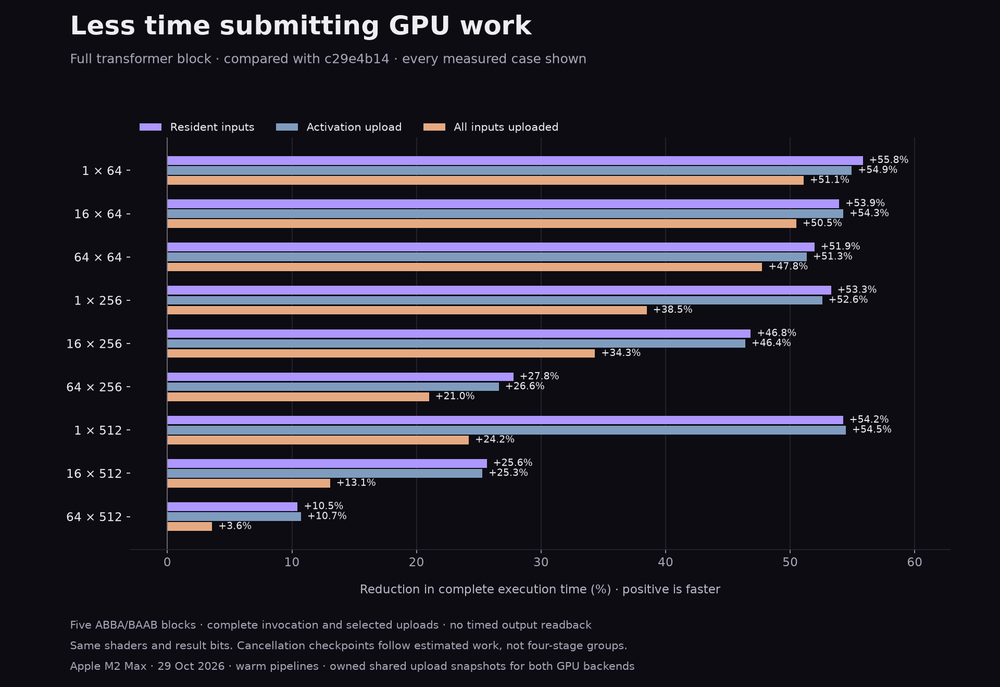

# Work-bounded GPU progression — 29 October 2026

Compiler-costed hardware float32 plans use a 64 Mi-unit estimated-work budget instead of also ending every four logical stages. The four parameter slots rotate into the retained owner vector; no floating arithmetic changes. Small transformer graphs use one submission rather than four. The 16×512 and 64×256 cases use three rather than five; 64×512 uses five rather than six. All retain 12 compute dispatches.

All 27 primary case medians improve: **10.5–55.8% less resident time**, **10.7–54.9% less activation-upload time**, and **3.6–51.1% less all-upload time**. One of 135 primary blocks regresses and remains included. Same-binary control and replication have positive medians and positive individual blocks throughout. The largest resident case is **7.10× faster than Kalandra CPU**, but still takes **2.93× MPSGraph time**; tiny cases still favor CPU.

Cancellation is still cooperative. Cheap stages may share a checkpoint, so this deliberately changes checkpoint granularity. Cancellation/fault precedence and acknowledgement-before-cleanup remain; neither the old nor new policy is a wall-clock deadline. Oversized individual kernels remain singleton quanta. Unproved plans, software arithmetic, tight budgets and long graphs retain the compatibility path.

## Frozen baseline comparison

Five fresh-process ABBA/BAAB blocks against `c29e4b14`, with identical batches within each pair. Positive means less whole-invocation time. Every case and every block is retained. The table gives the median paired time reduction and positive-block count.

| Tokens × width | Resident | Activation upload | All inputs uploaded |
|---|---:|---:|---:|
| 1 × 64 | +55.83% (5/5 positive) | +54.94% (5/5 positive) | +51.08% (5/5 positive) |
| 16 × 64 | +53.93% (5/5 positive) | +54.26% (5/5 positive) | +50.49% (5/5 positive) |
| 64 × 64 | +51.95% (5/5 positive) | +51.32% (5/5 positive) | +47.75% (5/5 positive) |
| 1 × 256 | +53.27% (5/5 positive) | +52.57% (5/5 positive) | +38.48% (5/5 positive) |
| 16 × 256 | +46.83% (5/5 positive) | +46.39% (5/5 positive) | +34.33% (5/5 positive) |
| 64 × 256 | +27.77% (5/5 positive) | +26.61% (5/5 positive) | +21.00% (5/5 positive) |
| 1 × 512 | +54.24% (5/5 positive) | +54.47% (5/5 positive) | +24.20% (5/5 positive) |
| 16 × 512 | +25.64% (5/5 positive) | +25.28% (5/5 positive) | +13.06% (5/5 positive) |
| 64 × 512 | +10.45% (4/5 positive) | +10.73% (5/5 positive) | +3.59% (5/5 positive) |

## Same-binary policy control

Three blocks per case with one candidate executable; only `workBoundedProgression` changes. This separates batching policy from changes in linking or runtime layout.

| Tokens × width | Resident | Activation | All uploads |
|---|---:|---:|---:|
| 1 × 64 | +54.73% (3/3 positive) | +53.78% (3/3 positive) | +48.60% (3/3 positive) |
| 16 × 64 | +54.48% (3/3 positive) | +54.08% (3/3 positive) | +50.31% (3/3 positive) |
| 64 × 64 | +51.73% (3/3 positive) | +50.32% (3/3 positive) | +35.18% (3/3 positive) |
| 1 × 256 | +53.26% (3/3 positive) | +52.75% (3/3 positive) | +37.87% (3/3 positive) |
| 16 × 256 | +47.39% (3/3 positive) | +47.30% (3/3 positive) | +34.60% (3/3 positive) |
| 64 × 256 | +26.15% (3/3 positive) | +24.74% (3/3 positive) | +20.82% (3/3 positive) |
| 1 × 512 | +53.66% (3/3 positive) | +54.41% (3/3 positive) | +26.00% (3/3 positive) |
| 16 × 512 | +26.59% (3/3 positive) | +26.04% (3/3 positive) | +11.52% (3/3 positive) |
| 64 × 512 | +9.76% (3/3 positive) | +9.20% (3/3 positive) | +6.13% (3/3 positive) |

## Independent replication

Five fresh blocks using the same frozen binaries, including the large control.

| Tokens × width | Resident | Activation | All uploads |
|---|---:|---:|---:|
| 1 × 64 | +54.85% (5/5 positive) | +53.25% (5/5 positive) | +49.19% (5/5 positive) |
| 1 × 512 | +53.48% (5/5 positive) | +53.25% (5/5 positive) | +24.29% (5/5 positive) |
| 16 × 512 | +25.19% (5/5 positive) | +25.18% (5/5 positive) | +11.19% (5/5 positive) |
| 64 × 512 | +10.81% (5/5 positive) | +11.08% (5/5 positive) | +5.74% (5/5 positive) |

## Fresh CPU and MPSGraph comparison

Five shuffled rounds of fresh processes. Times are process-median microseconds. GPU upload modes allocate and CPU-copy fresh owned shared buffers for both backends. Timings include invocation and cleanup, but exclude output readback, graph/pipeline preparation and cold compilation. CPU has no upload mode. This is an unmasked, single-head, bias-free pre-RMSNorm transformer block with a 4× ReLU FFN, not LLM generation.

| Tokens × width | Mode | CPU µs | Kalandra Metal µs | MPSGraph µs | Metal / MPS time |
|---|---|---:|---:|---:|---:|
| 1 × 64 | resident | 14.90 | 418.49 | 304.55 | 1.37× |
| 1 × 64 | activation | 14.90 | 429.29 | 307.11 | 1.40× |
| 1 × 64 | all uploads | 14.90 | 528.31 | 388.52 | 1.36× |
| 16 × 64 | resident | 69.14 | 430.78 | 304.73 | 1.41× |
| 16 × 64 | activation | 69.14 | 423.60 | 312.84 | 1.35× |
| 16 × 64 | all uploads | 69.14 | 517.91 | 386.08 | 1.34× |
| 64 × 64 | resident | 260.74 | 520.96 | 316.35 | 1.65× |
| 64 × 64 | activation | 260.74 | 523.70 | 329.09 | 1.59× |
| 64 × 64 | all uploads | 260.74 | 591.19 | 414.90 | 1.42× |
| 1 × 256 | resident | 59.01 | 458.66 | 303.14 | 1.51× |
| 1 × 256 | activation | 59.01 | 456.12 | 308.08 | 1.48× |
| 1 × 256 | all uploads | 59.01 | 808.27 | 647.45 | 1.25× |
| 16 × 256 | resident | 1158.45 | 584.88 | 366.83 | 1.59× |
| 16 × 256 | activation | 1158.45 | 602.25 | 380.81 | 1.58× |
| 16 × 256 | all uploads | 1158.45 | 944.61 | 722.38 | 1.31× |
| 64 × 256 | resident | 2736.49 | 1014.73 | 424.67 | 2.39× |
| 64 × 256 | activation | 2736.49 | 1039.34 | 437.36 | 2.38× |
| 64 × 256 | all uploads | 2736.49 | 1372.57 | 776.14 | 1.77× |
| 1 × 512 | resident | 251.07 | 421.15 | 317.50 | 1.33× |
| 1 × 512 | activation | 251.07 | 431.88 | 314.04 | 1.38× |
| 1 × 512 | all uploads | 251.07 | 1846.17 | 1742.44 | 1.06× |
| 16 × 512 | resident | 4798.80 | 972.03 | 446.75 | 2.18× |
| 16 × 512 | activation | 4798.80 | 992.03 | 465.05 | 2.13× |
| 16 × 512 | all uploads | 4798.80 | 2503.56 | 1884.15 | 1.33× |
| 64 × 512 | resident | 10902.67 | 1534.85 | 524.48 | 2.93× |
| 64 × 512 | activation | 10902.67 | 1581.15 | 551.24 | 2.87× |
| 64 × 512 | all uploads | 10902.67 | 3130.84 | 1972.62 | 1.59× |

## Separate profiling

Two fresh diagnostic processes per policy, shape and residency mode confirm all nine shapes retain exactly 12 dispatches and the audited submission counts. Acceptance timing leaves dispatch/device/encoding profiling disabled; those counters are zero there. The first short instrumented batches were too variable for timing inference, including reversed wall-time ordering in the largest case. The table instead uses a separate five-block paired diagnostic with adaptive batches of at least about 30 ms. None of these instrumented times replaces acceptance data. GPU command intervals include dispatch overhead and gaps within a command; changing command boundaries changes that accounting too. Recorded encoding omits some setup and is not an exhaustive CPU breakdown.

| Tokens × width | Policy | Wall µs | GPU command time µs | Recorded encoding µs | Allocation checkpoints |
|---|---|---:|---:|---:|---:|
| 1 × 512 | four stages | 939.54 | 170.58 | 71.25 | 112.00 |
| 1 × 512 | work budget | 431.83 | 156.66 | 59.20 | 109.00 |
| 64 × 512 | four stages | 1726.83 | 510.67 | 103.39 | 114.00 |
| 64 × 512 | work budget | 1562.06 | 508.92 | 101.62 | 113.00 |

The largest candidate spends roughly **0.51 ms inside GPU command intervals out of 1.56 ms wall time** in this paired diagnostic. This points to substantial remaining setup, submission, acknowledgement and queue-gap costs; it does not isolate any one of them. The next experiment should separately measure command-buffer creation, buffer/argument allocation and inter-command gaps before choosing a reusable-storage or submission-service design. The small and large candidate still encounter 109/113 allocation checkpoints per invocation.

## Qualification and limits

- All baseline/current/control result cells are bit-identical across 13 regular/odd shapes and all three residency modes. CPU and MPSGraph also satisfy the independent propagated numerical bounds. MPSGraph is not asserted bit-identical.
- All 23 shader text artifacts and CPU LLVM are unchanged; timing uses the exact original Metal library binaries. No reassociation, precision change or new vendor dependency.
- Prepared-program safety passes in optimized, debug, ASan/UBSan and TSan modes: changing captures, concurrent calls, allocation failures, teardown and every held cancellation/deadline/device-failure boundary. Small and large costed graphs have 1 and 5 boundaries; streaming retains 4 and 6.
- Higher-rank chains test 5/9/65/513 stages and ordinary, expensive, saturating, invalid and partially missing work metadata. Compiler tests check growing DAG costs and absence of proofs for software arithmetic.
- Broader runtime, upload, storage, compute, numeric, arithmetic-policy, pipeline, ReLU, optimization, graph-batching and tensor-transform tests pass. A stale register-selection assertion from the previous threshold change was corrected, with adjacent threshold shapes added to the independent APFloat test.
- No tests, builds, GPU profiling or plotting overlap acceptance measurements. Process load was sampled every 30 seconds. An earlier full paired run was contaminated by Android Studio Java at 693.1% CPU. A second attempt was interrupted when the user confirmed ongoing work; neither is acceptance evidence. All four accepted studies were restarted after the user explicitly confirmed idle. Their samples, the earlier complete run, and the interrupted log are retained.
- The initial prototype screen is separate evidence, not production qualification: it still used flat map cost estimates. Its script requires the c29e4b14 source checkout.
- MPSGraph remains a benchmark reference only. Small-workload GPU overhead and the largest matrix-kernel gap remain visible in the full table; these results do not establish general parity with vendor libraries.

## Evidence and reproduction

- [transformer-work-chunk-paired-2026-10-29.json](transformer-work-chunk-paired-2026-10-29.json)
- [transformer-work-chunk-control-2026-10-29.json](transformer-work-chunk-control-2026-10-29.json)
- [transformer-work-chunk-matched-2026-10-29.json](transformer-work-chunk-matched-2026-10-29.json)
- [transformer-work-chunk-repeat-2026-10-29.json](transformer-work-chunk-repeat-2026-10-29.json)
- [transformer-work-chunk-qualification-2026-10-29.json](transformer-work-chunk-qualification-2026-10-29.json)
- [transformer-work-chunk-screen-2026-10-29.json](transformer-work-chunk-screen-2026-10-29.json)
- [transformer-work-chunk-profile-2026-10-29.json](transformer-work-chunk-profile-2026-10-29.json)
- [transformer-work-chunk-contended-2026-10-29.json](transformer-work-chunk-contended-2026-10-29.json)
- [transformer-work-chunk-load-2026-10-29.json](transformer-work-chunk-load-2026-10-29.json)
- [transformer-work-chunk-load-interrupted-2026-10-29.json](transformer-work-chunk-load-interrupted-2026-10-29.json)
- [transformer-work-chunk-profile-paired-2026-10-29.json](transformer-work-chunk-profile-paired-2026-10-29.json)
- [Interrupted diagnostic log](transformer-work-chunk-interrupted-2026-10-29.log)

Run `native/benchmarks/work_chunk_acceptance.py` with `--acceptance-dir benchmarks/.build/gpu-upload-2026-10-29/acceptance`, `--program-dir benchmarks/.build/gpu-attention-2026-10-29/acceptance`, `--prepared-dir benchmarks/.build/gpu-work-chunks-2026-10-29/prepared`, and a fresh `--build-dir`. Studies are `paired` (5 blocks), `control` (3), `matched` (5), and `repeat` (5). Use a fresh output file for each study. Generated plans come from `PreparedNumericProgramTests.py`. Every raw record includes artifact hashes, calibration, warmup and measured samples, numerical verification and commands. See [the scheduling contract](../../docs/design/gpu-work-bounded-progression.md).
