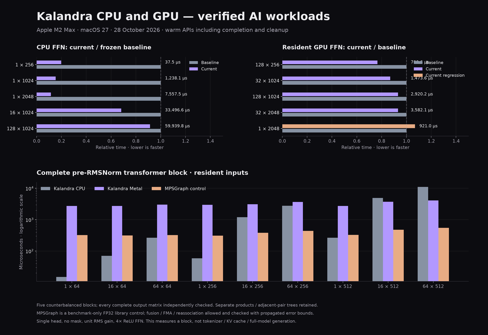

# Native AI performance — 28 October 2026

The five-stage sequence is implemented and locally qualified on Apple M2 Max / macOS 27. All timings are warm APIs; setup, process startup and pipeline/graph preparation are excluded. New Windows/Linux CPU gates are configured, but their hosted results are separate from these Mac measurements.

- CPU single-row residual FFNs take 80.2%, 84.5% and 88.4% less time at D=256/1024/2048 versus the frozen starting compiler.
- Larger resident GPU FFNs improve 6.0–24.0%. Small regressions remain, including 6.9% at 1×2048; this is not a universal GPU improvement.
- A complete transformer block now runs from Kalandra source on CPU and Metal. Resident Metal beats Kalandra CPU 1.34× at 16×512 and 2.71× at 64×512.
- Metal takes about 7.5–9.5× the MPSGraph time in resident cases. Optimized CPU libraries also remain ahead on most FFN shapes.
- No new universal C++/Rust ranking is inferred from tensor builtins. The ordinary affine/polynomial/GCD/mixed/array controls retain byte-identical generated LLVM IR versus the frozen compiler.

## What changed

CPU short-row kernels stream adjacent RHS columns through separately rounded register subtrees and bounded root storage. Batched float32 kernels use four rows by four columns; float64 retains its previous tile. General layouts, unsupported crossover shapes and odd tails retain checked fallbacks. No FMA/reassociation was introduced.

The legacy GPU graph donates only private, last-use, same-shape map backing and combines an eligible tail reduction within the existing four-stage / 64-Mi estimated-work batch allowance. Submitted resources remain retained through ACK, including failure, deadline and cancellation.

New rank-two primitives are `transpose`, `softmaxRows`, and `rmsNormRows`. Transpose preserves all ten numeric types bit-for-bit. CPU row math supports hardware float32/float64; Metal row math supports hardware float32. Unsupported software row arithmetic / GPU float64 row math reject explicitly. A typed float32 bridge reuses the independently qualified native Metal matrix profiles. Larger source matrix graphs outline checked helpers instead of relaxing the conservative stack budget.

## CPU residual FFN

`Y = ReLU(X W_up) W_down + X`, including invocation ownership, packing, intermediates and final adjacent-tree scalar observation. Percentages use median paired time reductions; elapsed values below use the median pair endpoints. Packing is charged and separately accounted as a K×N allocation; no isolated packing-cycle percentage is claimed.

| Rows × width | Baseline µs | Current µs | Less time |
|---|---:|---:|---:|
| 1 × 32 | 2.80 | 1.86 | 33.66% |
| 1 × 256 | 189.25 | 37.47 | 80.15% |
| 2 × 256 | 378.87 | 73.92 | 80.44% |
| 3 × 256 | 568.60 | 111.63 | 80.38% |
| 4 × 256 | 223.80 | 192.02 | 14.55% |
| 16 × 256 | 907.30 | 774.43 | 15.13% |
| 128 × 256 | 3,552.96 | 3,354.21 | 6.29% |
| 1 × 1024 | 8,065.44 | 1,238.14 | 84.52% |
| 4 × 1024 | 13,569.65 | 9,000.02 | 36.68% |
| 16 × 1024 | 49,064.06 | 33,496.65 | 32.15% |
| 32 × 1024 | 22,885.81 | 21,119.65 | 8.61% |
| 128 × 1024 | 65,570.48 | 59,939.81 | 8.59% |
| 1 × 2048 | 65,613.58 | 7,557.53 | 88.39% |
| 32 × 2048 | 117,447.06 | 116,029.62 | 2.00% |

CPU library controls use the same data and equation, with their ordinary optimized FP32 accumulation. They permit FMA/reassociation and are checked against a float64 reference with propagated gamma bounds. Accelerate is reference-only; Kalandra does not link it.

| Rows × width | Kalandra µs | OpenBLAS 1 thread µs | OpenBLAS 12 threads µs | Accelerate 1 thread µs | Accelerate AUTO µs |
|---|---:|---:|---:|---:|---:|
| 1 × 256 | 37.12 | 32.09 | 31.71 | 6.87 | 7.00 |
| 16 × 256 | 766.66 | 255.55 | 869.67 | 20.75 | 20.62 |
| 128 × 256 | 3,325.27 | 1,501.48 | 2,083.14 | 138.42 | 134.86 |
| 1 × 1024 | 1,033.21 | 950.85 | 499.60 | 794.66 | 784.01 |
| 32 × 1024 | 21,112.21 | 7,057.15 | 6,338.92 | 1,677.11 | 989.04 |
| 128 × 1024 | 59,932.17 | 23,066.08 | 16,574.07 | 3,063.07 | 2,373.47 |
| 1 × 2048 | 8,092.79 | 4,790.85 | 2,218.25 | 6,031.72 | 6,178.93 |
| 32 × 2048 | 116,896.88 | 29,346.50 | 20,168.64 | 16,186.33 | 8,228.68 |

## GPU residual FFN

Same frozen compiler-emitted shaders and task archive around old/new production Metal runtimes. Scalar result readback is included. Percentages are paired time reductions, with negative values retained as regressions.

| Rows × width | Resident baseline µs | Resident current µs | Resident less time | Activation upload less time | All uploads less time |
|---|---:|---:|---:|---:|---:|
| 1 × 256 | 464.32 | 475.40 | -1.93% | -4.19% | 2.04% |
| 16 × 256 | 564.68 | 557.94 | 1.17% | -0.24% | -0.62% |
| 128 × 256 | 913.72 | 700.63 | 24.04% | 17.33% | 12.29% |
| 1 × 1024 | 543.00 | 535.71 | 1.97% | 3.82% | -0.61% |
| 32 × 1024 | 1,694.41 | 1,473.60 | 11.75% | 10.95% | 3.76% |
| 128 × 1024 | 3,134.31 | 2,920.23 | 10.03% | 9.75% | 4.57% |
| 1 × 2048 | 861.30 | 920.99 | -6.93% | 0.10% | -0.33% |
| 32 × 2048 | 3,844.51 | 3,582.11 | 6.01% | 6.24% | 0.59% |

## Complete transformer block

Bias-free single-head unmasked pre-RMSNorm encoder; separate Q/K/V and output projections; attention softmax; two residuals; explicit epsilon and scale; unit RMS gain; 4x ReLU FFN. No KV cache, masks, tokenizer or generation.

Warm synchronous tensor-result API, complete device ACK and invocation cleanup; no output readback in timing on either GPU. Pipeline/graph preparation excluded. Mode 0 all resident; mode 1 activation upload; mode 2 all seven inputs uploaded per call. CPU includes native invocation ownership cleanup. Fresh processes, two warmup batches, three measured batches, reversed CPU/GPU/MPS/MPS/GPU/CPU orders; implementation-specific calibrated counts avoid huge duration skew.

The source has distinct hashed Q/K/V/output/FFN weights. All 13 verification shapes (nine timed and four odd/non-dyadic) pass complete per-cell checks on CPU, Metal and MPSGraph in all residency modes. Eight observable source prefixes independently verify normalized inputs, Q/K/V, attention probabilities, attention residual, second normalization and FFN hidden output. The norm/Q/K/V prefix outputs are bit-exact against the separately rounded reference; later outputs use propagated math/rounding bounds.

| Sequence × width | CPU µs | Metal µs | MPSGraph µs | CPU / Metal speedup | Metal / MPS time |
|---|---:|---:|---:|---:|---:|
| 1 × 64 | 14.98 | 2,754.56 | 321.77 | 0.01× | 8.56× |
| 16 × 64 | 70.09 | 2,729.24 | 315.15 | 0.03× | 8.66× |
| 64 × 64 | 266.99 | 3,012.33 | 324.04 | 0.09× | 9.30× |
| 1 × 256 | 58.84 | 2,968.40 | 311.52 | 0.02× | 9.53× |
| 16 × 256 | 1,196.15 | 3,126.89 | 380.86 | 0.38× | 8.21× |
| 64 × 256 | 2,765.13 | 3,675.39 | 441.56 | 0.75× | 8.32× |
| 1 × 512 | 265.67 | 2,738.28 | 326.15 | 0.10× | 8.40× |
| 16 × 512 | 4,964.58 | 3,706.72 | 478.30 | 1.34× | 7.75× |
| 64 × 512 | 11,087.03 | 4,096.17 | 546.55 | 2.71× | 7.49× |

The MPSGraph framework emitted `Failed to import MPS module` during preparation. The diagnostic is retained in raw evidence; execution succeeded through the explicitly supplied Metal command buffer/device, and all numerical checks passed. No internal MPS dispatch count is claimed.

## Remaining architectural gap

Separate instrumented runs retain the same frozen kernels/runtime archives and explicitly enable nonzero runtime counters. These are diagnostic times, not acceptance timings. Recorded encoding does not include every helper/setup cost and the remaining wall time is not assigned wholly to one subsystem.

| Sequence × width | Instrumented wall µs | GPU command time µs | Recorded encoding µs | Submissions | Dispatches | Allocation/admission checkpoints |
|---|---:|---:|---:|---:|---:|---:|
| 1 × 512 | 3,706.22 | 574.06 | 164.46 | 16 | 16 | 235 |
| 64 × 512 | 4,037.96 | 836.98 | 208.93 | 16 | 16 | 235 |

The next change needs a prepared typed GPU execution plan with bounded command chunks and ownership-aware temporary reuse. Sixteen per-stage ACK boundaries and 235 allocation/admission checkpoints remain even with preloaded kernels. Batch admission must preserve checked-operation first faults, stop at device-dependent/error-producing boundaries, and retain all owners/fault flags through real completion; the successful legacy graph optimization cannot simply be copied across arbitrary typed operations. Cancellation and strict arithmetic should stay intact. After reducing lifecycle costs, native matrix/row kernels still need separate GPU-time work to close the library gap.

## Qualification and reproducibility

CPU/GPU tensor operations passed optimized, debug, ASan/UBSan and TSan checks, including empty axes, general CPU strides, input immutability, numerical extremes, allocation injection, mid-loop CPU cancellation, held GPU cancellation/deadline/device failure and cleanup. The typed float32 matrix bridge passed 1,724 APFloat cases and 1,598,840 output checks per mode. Existing source regression suites and four typed matrix program/control gates passed. Authored/rendered docs verified all 68 code blocks (36 CPU programs, three GPU programs, plus classified module/setup examples).

No frequency pinning, thermal control, affinity or desktop isolation is claimed. Other physical devices/platforms need their own qualification. Historical screen/repeat reports preserve losing candidates and timing variability; final reports do not overwrite them. Large executable/IR/toolchain artifacts remain in ignored experiment storage, not tracked benchmark results.

Raw final evidence:

- [ai-cpu-final-2026-10-28.json](ai-cpu-final-2026-10-28.json)
- [ai-gpu-final-2026-10-28.json](ai-gpu-final-2026-10-28.json)
- [ai-ffn-cpu-library-final-2026-10-28.json](ai-ffn-cpu-library-final-2026-10-28.json)
- [transformer-block-performance-2026-10-28.json](transformer-block-performance-2026-10-28.json)
- [transformer-block-profile-2026-10-28.json](transformer-block-profile-2026-10-28.json)
- [transformer-stages-qualification-2026-10-28.json](transformer-stages-qualification-2026-10-28.json)

Source/artifact digests were rechecked by `native/benchmarks/fair/ai_report.py`; the audit and plotted inputs are saved beside this report.
